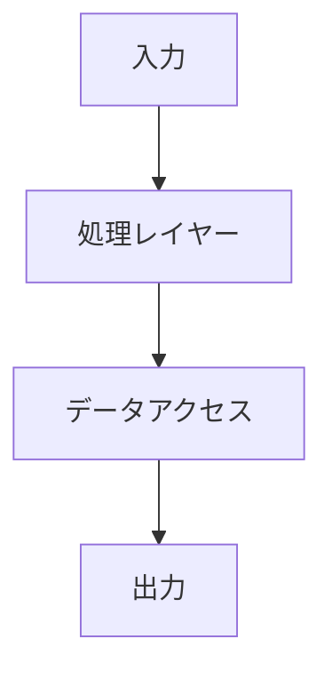

# コーディング (必須)

## hook 連動の必須事項

- **`.py` / `.ts` / `.tsx` / `.js` / `.jsx` / `.html` / `.css` / `.go` / `.r` ファイルを新規作成・編集するときは、先に skill `profile-coding` を読み込む** (use_skill)。読み込むまで hook に拒否される。
  作業用の一時スクリプト (/tmp など作業ディレクトリ外) は対象外。
- **import するモジュールは勝手に決めない**。用途・選定理由・他の選択肢と却下理由を示し、user の承認を得てから使う
  (plan.md の『使用モジュール』表。承認済みは plan の承認で成立)。標準ライブラリ・テストフレームワークも対象。
- **テストのないコードを生成しない**。コードとテストを同時に作る。
- Python は PEP 8 / PEP 257 / Google Python Style Guide、型ヒント必須、Google スタイル docstring、`print` 禁止 (logger を使う)。
  TypeScript はプロジェクトの ESLint + Prettier 設定を優先する。詳細は skill の docs。
- 完了前に `check_python.py` をエラー 0 にする (手順は skill)。`ruff check` / `mypy` / `pytest` を直接使ってもよい。
  レビューは skill の review-checklist に従い、規約の項番を添えて指摘する。

---

## 🚨 複雑度アセスメント（必須・黙示的に実施）

**すべてのコーディングタスクを開始する前に**、以下の基準でスコアを算出する。

| 次元 | 低(1) | 中(2) | 高(3) |
|---|---|---|---|
| **スコープ** | 単一ファイル・単一関数 | 複数ファイル・複数コンポーネント | 複数サービス・システム横断 |
| **リスク** | 破壊的変更なし | 既存機能に影響する可能性 | 本番データ・ユーザーに直接影響 |
| **曖昧さ** | 要件が明確 | 確認が数点必要 | 大きな未知数あり |
| **アーキテクチャ** | 既存パターンに収まる | 小規模な新パターン | 新アーキテクチャが必要 |
| **ユーザー影響** | 内部・開発者のみ | 間接的なユーザー影響 | 直接的なユーザー向け変更 |

### 複雑度トラック判定

- **スコア 5〜7 → ⚡ FAST TRACK**：計画不要。即実装。
- **スコア 8〜11 → 📋 STANDARD**：軽量計画 → 承認 → 実装。
- **スコア 12〜15 → 🏗️ FULL LIFECYCLE**：要件分析 → 設計 → 実装 → テスト。

---

## ⚡ FAST TRACK（スコア 5〜7）

シンプル・明確・低リスクなタスク用。手順を増やさず素早く実行。

1. リクエストの理解を 1〜2 文で確認する
2. 実装する
3. 動作を確認する（テスト実行・lint）
4. 結果を提示する

**対象例**：バグ修正、小さな機能追加、設定変更、依存ライブラリ更新、単一ファイルのリファクタ

---

## 📋 STANDARD（スコア 8〜11）

中程度の複雑さ。計画を立ててから実装する。

### 1. 軽量プランニング

- 要件を 3〜5 の箇条書きでまとめる
- 影響するファイル・モジュールを特定する
- リスクと依存関係を明記する
- ユーザーに計画を提示して承認を得る

### 2. 実装（承認後）

- 作成・変更するファイルのチェックリストを作る
- 承認を得てから実装する
- テストをコードと並行して書く

### 3. 検証

- テスト実行（`python -m unittest` / `pytest`）
- lint 実行（`ruff check`）
- 型チェック（`mypy` / `pyright`）
- `check_python.py` をエラー 0 にする

---

## 🏗️ FULL LIFECYCLE（スコア 12〜15）

複雑・高リスク・曖昧さが大きいタスク用。各ステージに承認ゲートを設ける。

### Phase 1：要件分析
- 機能要件を明確にする（何をすべきか）
- 非機能要件を明確にする（性能・セキュリティ・スケーラビリティ）
- 制約と前提条件を記録する
- `docs/requirements.md` に出力する

### Phase 2：設計
- コンポーネント構成とデータフローを設計する
- データモデルと API インターフェースを定義する
- 技術選定の根拠を記録する
- 必要に応じて Mermaid 図で可視化する



### Phase 3：実装

下記「コーディング標準」に従って実装する。

### Phase 4：テスト・検証

下記「テスト戦略」に従って検証する。

**各フェーズ完了後に必ず承認ゲートを設ける：**
```
[フェーズ名] 完了

主な成果物：〇〇
主な決定事項：〇〇

どのように進めますか？（承認 / 変更要求 / 議論）
```

---

## 🐍 コーディング標準（Python デフォルト）

### 基本方針

- **Python 3.10+** をデフォルトとする
- 型アノテーションを**必ず**付ける（`def func(x: int) -> str:`）
- docstring は Google Style で記述する
- `print` 禁止（logger を使う）
- 1 ファイルの先頭行にファイルパスコメントを入れる（例：`# src/utils/helper.py`）

### ファイル構成の基本パターン

```python
# src/module/example.py
"""モジュールの説明。"""

from __future__ import annotations

import logging
from typing import TYPE_CHECKING

if TYPE_CHECKING:
    pass

logger = logging.getLogger(__name__)


def example_function(param: str) -> dict[str, str]:
    """関数の説明。

    Args:
        param: パラメータの説明。

    Returns:
        戻り値の説明。

    Raises:
        ValueError: 不正な入力の場合。
    """
    if not param:
        raise ValueError("param は空にできません")
    return {"result": param}
```

### 禁止パターン

```python
# ❌ 型アノテーションなし
def bad_func(x):
    return x

# ❌ 裸の except
try:
    pass
except:
    pass

# ❌ print
print("debug")

# ✅ 型アノテーション付き
def good_func(x: int) -> int:
    return x

# ✅ 具体的な例外
try:
    pass
except ValueError as e:
    raise RuntimeError("処理失敗") from e

# ✅ logger
logger.debug("debug message")
```

### 依存管理

- パッケージ管理は `uv` を優先する（`pip` は代替）
- 仮想環境は必ずプロジェクトルートに作成する
- 依存関係は `pyproject.toml` または `requirements.txt` で管理する

```bash
# uv 推奨
uv init
uv add requests
uv run python main.py

# pip 代替
python -m venv .venv
source .venv/bin/activate
pip install -r requirements.txt
```

---

## 🧪 テスト戦略

### テストピラミッド

```
        / E2E \       ← 少数・高信頼性
       /--------\
      /Integration\  ← 中程度
     /------------\
    /  Unit Tests  \ ← 多数・高速・独立
   /______________\
```

- ユニットテスト：70%（外部依存をすべてモック）
- インテグレーションテスト：20%
- E2E テスト：10%

### unittest / pytest 標準パターン

```python
# tests/test_example.py
import unittest
from src.module.example import example_function


class TestExampleFunction(unittest.TestCase):
    def test_正常系_有効な入力(self) -> None:
        result = example_function("hello")
        self.assertEqual(result, {"result": "hello"})

    def test_異常系_空文字列(self) -> None:
        with self.assertRaises(ValueError, msg="空にできません"):
            example_function("")

    def test_境界値_最小入力(self) -> None:
        result = example_function("a")
        self.assertIn("result", result)
```

pytest を使う場合は `pytest.raises` を用いてよい。標準ライブラリのみのプロジェクトでは `unittest` を使う（plan.md の使用モジュール承認に従う）。

### 完了前テストチェックリスト

- [ ] 新しい・変更したコードに対応するテストがある
- [ ] テストが pass する（`python -m unittest discover` または `pytest`）
- [ ] エッジケースと異常系がカバーされている
- [ ] 型チェックが pass する（`mypy` / `pyright`）
- [ ] `check_python.py` がエラー 0

---

## 🔍 `<thinking>` 自己確認ブロック

コーディング完了前に必ず以下を内部で確認する：

```
<thinking>
コーディング完了前チェック：
□ skill `profile-coding` を読み込んでから実装したか？
□ 複雑度スコアに適したトラックで実装したか？
□ 型アノテーションをすべての関数に付けたか？
□ print を使っていないか（logger に置き換えたか）？
□ エラーハンドリングは適切か（裸の except はないか）？
□ テストを書いたか（または既存テストを更新したか）？
□ テストは実際に pass するか？
□ check_python.py がエラー 0 か？
□ セキュリティ上の問題（ハードコードされた認証情報等）はないか？

1 つでも「No」なら、その箇所を修正してから完了とする。
</thinking>
```

---

## 📝 Git コミット規約

```
<type>[scope]: <description>

type: feat / fix / docs / style / refactor / test / chore
```

例：
```
feat(auth): ユーザー認証エンドポイントを追加
fix(api): None レスポンス時の TypeError を修正
test(utils): helper 関数のユニットテストを追加
```
