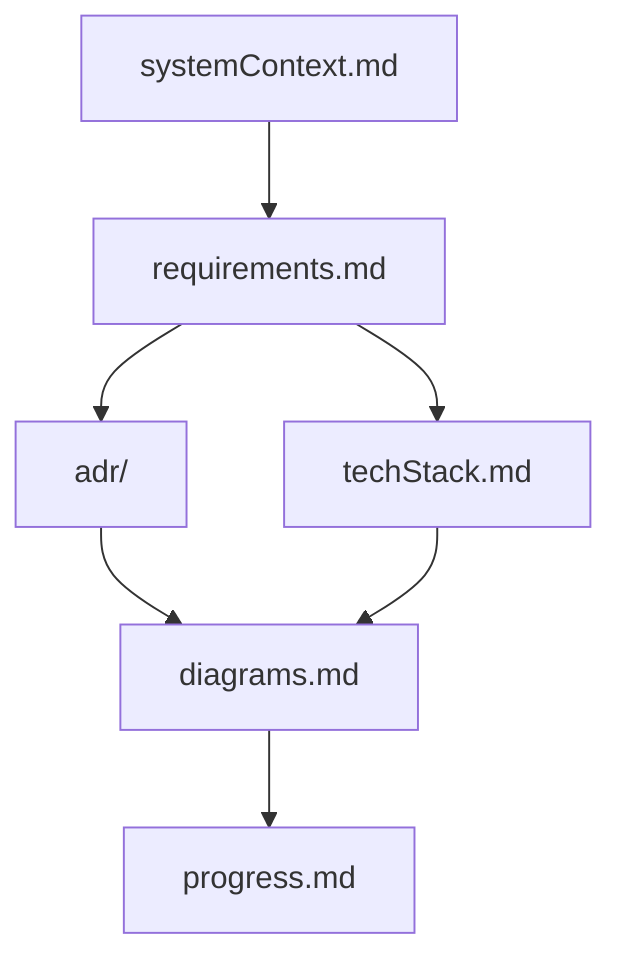
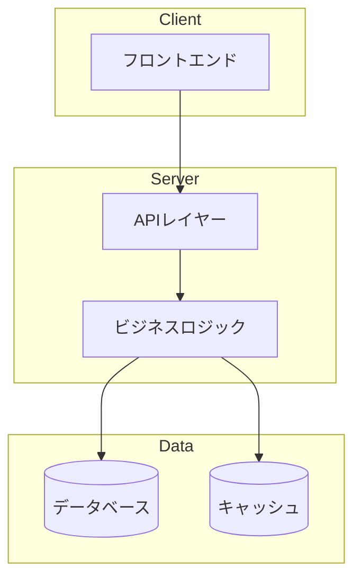
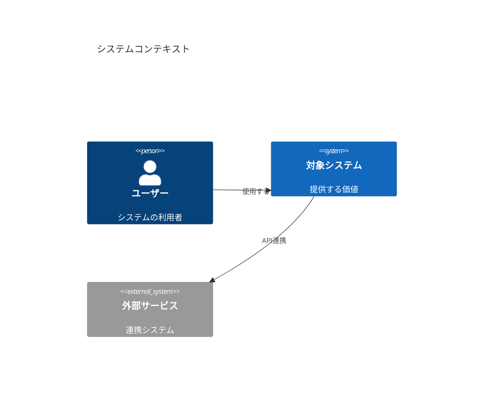

# 🏗️ アーキテクチャ計画ルール

## 🎯 このルールが起動する条件

以下のキーワードを含むリクエストで起動します：

- 「アーキテクチャについて」「設計して」「システム設計」
- 「技術選定」「構成を考えて」「どう作るべきか」
- 「DB設計」「API設計」「インフラ設計」
- 「スケーラビリティ」「パフォーマンス設計」「マイクロサービス」

---

## 🚨 INITIALIZATION PROTOCOL（必須）

**すべてのアーキテクチャタスクの開始時に必ず実行する：**

```
<thinking>
初期化チェック：
□ Architecture Memory Bankのファイルが存在するか確認したか？
  （arch-bank/systemContext.md 等）
□ 既存のADR（アーキテクチャ決定記録）を読み込んだか？
□ 現在の進捗状況（arch-bank/progress.md）を確認したか？
□ 非機能要件（性能・セキュリティ・スケーラビリティ）を把握したか？
□ 制約条件（予算・期間・チーム規模）を確認したか？
</thinking>
```

---

## 🗂️ Architecture Memory Bank（セッション継続性）

アーキテクチャ設計はセッションをまたいで継続するため、以下の構造でファイルを管理する。

```
arch-bank/
  systemContext.md      ← システムの目的・ステークホルダー・制約
  requirements.md       ← 機能要件・非機能要件
  adr/                  ← アーキテクチャ決定記録（ADR）
    adr-001-[title].md
    adr-002-[title].md
  diagrams.md           ← Mermaidアーキテクチャ図のコレクション
  techStack.md          ← 技術スタック選定とその根拠
  progress.md           ← 現在の進捗・未解決事項・次のステップ
```



### Memory Bank 更新トリガー

以下の状況で必ず更新する：
1. 重要なアーキテクチャ決定をしたとき → ADRを追加
2. 技術スタックが変更されたとき → techStack.mdを更新
3. 要件が変わったとき → requirements.mdを更新
4. ユーザーが **「アーキテクチャバンクを更新して」** と指示したとき（全ファイルを見直す）

---

## 🚨 STEP 0：複雑度アセスメント（必須・黙示的に実施）

**すべてのアーキテクチャタスクを開始する前に**、以下の基準でスコアを算出する。

| 次元 | 低(1) | 中(2) | 高(3) |
|---|---|---|---|
| **スコープ** | 単一コンポーネント | 複数コンポーネント | 複数サービス・システム横断 |
| **リスク** | 既存に影響なし | 既存コンポーネントに影響 | 本番サービス・データに影響 |
| **曖昧さ** | 要件が明確 | 確認が数点必要 | 大きな未知数・未定要件 |
| **アーキテクチャ** | 既存パターン拡張 | 新しいパターン導入 | 全体的な再設計 |
| **チーム影響** | 個人プロジェクト | 小チーム（〜5人） | 大チーム・組織横断 |

### 複雑度トラック判定

- **スコア 5〜7 → ⚡ FAST TRACK**：簡易設計メモで即決。
- **スコア 8〜11 → 📋 STANDARD**：軽量設計 → 承認 → ADR記録。
- **スコア 12〜15 → 🏗️ FULL LIFECYCLE**：完全なAI-DLCフローを実行。

---

## ⚡ FAST TRACK（スコア 5〜7）

- 設計の意図を1〜2文で明確化する
- Mermaidで簡易図を1枚描く
- 主要な技術選定とその理由を箇条書きする
- ADR（簡易版）を記録する

---

## 📋 STANDARD（スコア 8〜11）

### 1. 要件サマリー（3〜5箇条書き）

- 機能要件：何を実現するか
- 非機能要件：性能・信頼性・スケーラビリティ
- 制約：使用できる技術・予算・期間

### 2. アーキテクチャ設計

コンポーネント図をMermaidで描き、承認を得る：



### 3. 技術選定

```markdown
| レイヤー | 選定技術 | 採用理由 | 代替案 |
|---|---|---|---|
| バックエンド | FastAPI | 高速・型安全・Python | Flask / Django |
| データベース | PostgreSQL | ACID準拠・JSONサポート | MySQL / SQLite |
| キャッシュ | Redis | 高速・多機能 | Memcached |
```

### 4. ADR記録

→ `arch-bank/adr/adr-XXX-[title].md` に記録する

---

## 🏗️ FULL LIFECYCLE（スコア 12〜15）

AI-DLCの完全なフローを実行する。各ステージに承認ゲートを設ける。

### 🔵 Phase 1：Inception（要件定義）

**Stage 1-1: ワークスペース検出**
- 既存コードベースをスキャンする（Greenfield / Brownfield判定）
- 現在の技術スタックを特定する
- 既存のアーキテクチャパターンを記録する

**Stage 1-2: 要件分析**
- 機能要件（何をすべきか）
- 非機能要件（性能・セキュリティ・スケーラビリティ・可用性）
- 制約と前提条件
- → `arch-bank/requirements.md` に出力する

**Stage 1-3: ステークホルダー分析**（必要な場合）
- 誰が使うか・誰が影響を受けるか
- 各ステークホルダーの優先関心事

**Stage 1-4: 作業単位の分解**
- システムをビルド可能な単位に分解する
- 依存関係とビルド順序を定義する
- → `arch-bank/progress.md` に記録する

**▶ 承認ゲート**
```
[Phase 1: Inception] 完了

主な成果物：requirements.md 作成
主な決定事項：〇〇
未解決事項：〇〇

どのように進めますか？（承認 / 変更要求 / 議論）
```

---

### 🟢 Phase 2：Construction（設計）

**Stage 2-1: アーキテクチャ設計**

C4モデルで段階的に設計する：

```
Level 1：システムコンテキスト図（外部との関係）
Level 2：コンテナ図（主要コンポーネント）
Level 3：コンポーネント図（内部構造）
Level 4：コード図（必要な場合のみ）
```

**Level 1 例：**


**Stage 2-2: データ設計**
- データモデル（ERD）
- データフロー
- データの境界と整合性

**Stage 2-3: API設計**（必要な場合）
- エンドポイント一覧
- リクエスト/レスポンス形式
- 認証・認可方式

**▶ 承認ゲート**
```
[Phase 2: Construction] 完了

主な成果物：diagrams.md / techStack.md 作成
主な決定事項：〇〇
ADR記録：〇〇

どのように進めますか？
```

---

## 📝 ADR（アーキテクチャ決定記録）テンプレート

重要なアーキテクチャ決定は必ずADRに記録する：

```markdown
<!-- arch-bank/adr/adr-001-[決定タイトル].md -->
# ADR-001: [決定のタイトル]

## ステータス
提案中 / 承認済み / 非推奨 / 置換済み

## コンテキスト
[なぜこの決定が必要になったか。背景と状況を記述する]

## 決定内容
[何を決めたか。具体的に記述する]

## 採用理由
[なぜこの選択をしたか。検討した代替案と比較して]

## 結果
### ポジティブな影響
- [メリット1]
- [メリット2]

### ネガティブな影響・トレードオフ
- [デメリット1・受け入れたトレードオフ]

## 関連ADR
- ADR-002: [関連する決定]
```

---

## 🔍 `<thinking>` 自己確認ブロック

アーキテクチャ設計完了前に必ず確認する：

```
<thinking>
アーキテクチャ設計完了前チェック：
□ Architecture Memory Bankを読み込んで既存の文脈を把握したか？
□ 複雑度スコアに適したトラックで設計したか？
□ 非機能要件（性能・セキュリティ・スケーラビリティ）を考慮したか？
□ 重要な技術選定にADRを記録したか？
□ Mermaid図で設計を可視化したか？
□ 各フェーズの承認ゲートを通過したか？
□ progress.mdを更新したか？
□ トレードオフを明示したか（「なぜXでなくYを選んだか」）？

未記録の決定事項があれば、完了前にADRに記録する。
</thinking>
```

---

## 📤 ルール間の引き継ぎ

| 次のアクション | 参照ルール |
|---|---|
| 設計に基づいてコーディングを開始したい | → `coding.md` を参照 |
| UIアーキテクチャ・画面設計を進めたい | → `design.md` を参照 |
| 技術選定のリサーチをしたい | → `web_search.md` を参照 |
| 既存のアーキテクチャをレビューしたい | → `code_review.md` を参照 |

---

## ⚠️ コンテキストウィンドウ管理

コンテキスト使用率が **50%を超えたら**：

1. 現在のフェーズを区切りのよいところで完了させる
2. `arch-bank/progress.md` に現在の状態を記録する：
   - 完了したフェーズとその成果物
   - 未解決事項
   - 次のステップ
3. 未記録のADRがあれば `arch-bank/adr/` に保存してから引き継ぐ
