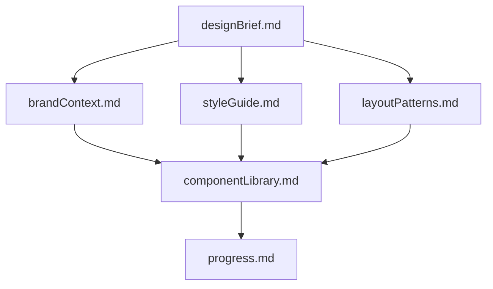
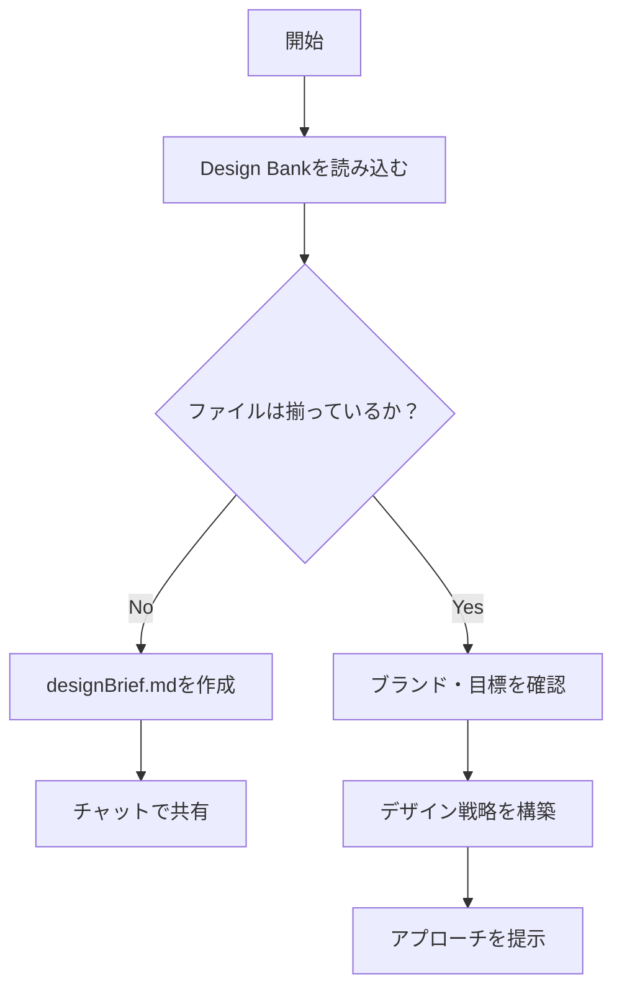
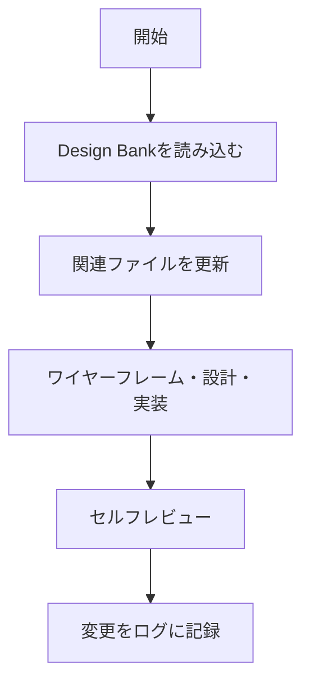
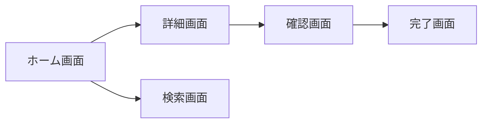

# 🎨 デザインルール

## 🎯 このルールが起動する条件

以下のキーワードを含むリクエストで起動します：

- 「〜をデザインして」「デザインのプランを作成して」
- 「UI/UXを考えて」「画面設計して」「ワイヤーフレームを作って」
- 「デザインシステムを」「コンポーネントを設計して」
- 「見た目を改善して」「レイアウトを変更して」

---

## 🚨 INITIALIZATION PROTOCOL（必須）

**すべてのデザインタスクの開始時に必ず実行する：**

```
<thinking>
初期化チェック：
□ Web Design Bankのファイルが存在するか確認したか？
  （design-bank/designBrief.md 等）
□ 既存のブランドコンテキストを読み込んだか？
□ 現在の進捗状況（progress.md）を確認したか？
□ デザインの要件と目標を理解したか？
□ アクセシビリティ要件を確認したか？
</thinking>
```

---

## 🗂️ Web Design Bank（セッション継続性）

デザイン情報はセッションをまたいで維持するため、以下の構造でファイルを管理する。

```
design-bank/
  designBrief.md       ← プロジェクトの目的・スコープ・成功基準
  brandContext.md      ← ブランド価値・トーン・カラーパレット
  styleGuide.md        ← タイポグラフィ・カラートークン・スペーシング
  layoutPatterns.md    ← グリッド・ブレークポイント・セクション設計
  componentLibrary.md  ← 再利用可能UIコンポーネント定義
  progress.md          ← 現在の進捗・完了済み・未完了タスク
```



### ファイルが存在しない場合

`design-bank/designBrief.md` が存在しない場合、以下を確認して作成する：

```markdown
<!-- design-bank/designBrief.md の基本構造 -->
## プロジェクト概要
## ターゲットユーザー
## 主要機能・画面
## 成功基準・KPI
## 制約・禁止事項
```

### Design Bank 更新トリガー

以下の状況で必ず更新する：
1. 新しいレイアウト・インタラクションパターンが生まれたとき
2. スタイルトークン・コンポーネント定義が変わったとき
3. ユーザーフィードバック・テスト知見があったとき
4. ユーザーが **「デザインバンクを更新して」** と指示したとき（全ファイルを見直す）

---

## 📋 ワークフロー

### Plan モード



### Act モード



---

## 🎨 デザインの実行原則

### pause-ask-refine プロトコル（重要）

デザインは特に「確認しながら進める」ことが重要。以下を徹底する：

| 原則 | 実行方法 |
|---|---|
| **一度に一箇所** | 一度のアップデートで変更するのは1セクション/1側面のみ |
| **変更後に確認** | 各更新後に必ずレビューを依頼する |
| **明示的な承認** | 次のステップに進む前に明確な同意を得る |
| **最大3回の精緻化** | 3サイクル試みても合意できない場合は未解決として記録 |

### デザイン判断の優先順位

1. **ユーザビリティ**（使いやすさ）を最優先
2. **アクセシビリティ**（WCAG 2.1 AA 準拠）
3. **一貫性**（Design Bankのスタイルガイドに従う）
4. **審美性**（ブランドコンテキストに沿った美しさ）

---

## 🖼️ アウトプット形式

### ワイヤーフレーム（Mermaid / テキスト）

Mermaid図で画面遷移・レイアウト構造を可視化する：



### スタイルガイド出力例

```markdown
## カラートークン
| トークン | 値 | 用途 |
|---|---|---|
| `--color-primary` | `#2563EB` | メインアクション・リンク |
| `--color-secondary` | `#7C3AED` | サブアクション |
| `--color-surface` | `#F8FAFC` | 背景・カード |
| `--color-text` | `#1E293B` | 本文テキスト |

## スペーシングスケール（4の倍数）
4px / 8px / 12px / 16px / 24px / 32px / 48px / 64px

## タイポグラフィ
| ロール | サイズ | 行間 | ウェイト |
|---|---|---|---|
| Heading 1 | 2rem | 1.2 | 700 |
| Heading 2 | 1.5rem | 1.3 | 600 |
| Body | 1rem | 1.6 | 400 |
| Caption | 0.875rem | 1.5 | 400 |
```

### コンポーネント定義出力例

```markdown
## ボタンコンポーネント

### Primary Button
- 背景：`--color-primary`
- テキスト：白
- パディング：`12px 24px`
- 角丸：`8px`
- ホバー：`opacity: 0.9`
- フォーカス：`outline: 2px solid --color-primary; outline-offset: 2px`（アクセシビリティ）

### Disabled State
- 背景：`--color-surface`
- テキスト：`--color-text-disabled`
- cursor: not-allowed
```

---

## ♿ アクセシビリティチェックリスト（WCAG 2.1 AA）

完了前に必ず確認する：

- [ ] カラーコントラスト比：本文 4.5:1 以上、大きな文字 3:1 以上
- [ ] インタラクティブ要素はキーボードで操作可能か
- [ ] フォーカスインジケーターが視覚的に確認できるか
- [ ] 画像に適切な alt テキストがあるか
- [ ] フォーム要素にラベルが関連付けられているか
- [ ] 色だけで情報を伝えていないか（アイコン・テキストを併用）

---

## 🔍 `<thinking>` 自己確認ブロック

デザイン完了前に必ず確認する：

```
<thinking>
デザイン完了前チェック：
□ Design Bankの全ファイルを読み込んで文脈を把握したか？
□ 一度に変更したのは1セクションのみか？
□ 各変更後にユーザーの確認を取ったか？
□ styleGuide.mdのトークン・スペーシングに従っているか？
□ WCAGアクセシビリティ基準を満たしているか？
□ progress.mdを更新したか？
□ componentLibrary.mdに新しいコンポーネントを記録したか？

未更新のファイルがあれば、完了前に更新する。
</thinking>
```

---

## 📤 ルール間の引き継ぎ

| 次のアクション | 参照ルール |
|---|---|
| デザインをコードで実装したい | → `coding.md` を参照 |
| 情報設計・コンテンツリサーチをしたい | → `web_search.md` を参照 |
| システムアーキテクチャと合わせて設計したい | → `architecture_planning.md` を参照 |
| 実装したUIコードをレビューしたい | → `code_review.md` を参照 |

---

## ⚠️ コンテキストウィンドウ管理

コンテキスト使用率が **50%を超えたら**：

1. 現在のデザインタスクを区切りのよいところで完了させる
2. `design-bank/progress.md` に現在の状態・次のステップを記録する
3. 次のセッションで Design Bank を再読み込みすることを伝える
